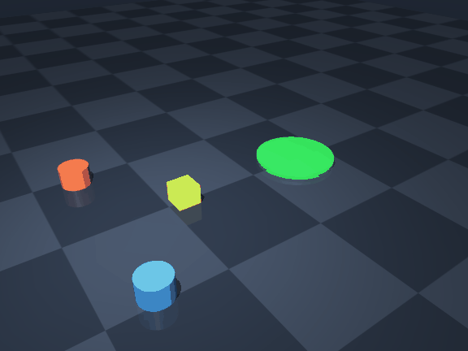
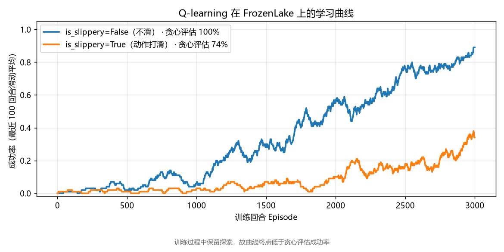

# embodied-marl

在 MuJoCo 物理仿真中训练多个机器人协作完成任务。

当前任务：两个机器人把一个方块推到目标区域。



*当前为随机策略，用于验证环境与渲染流水线。*

## 状态

- [x] 物理场景（`assets/coop_push.xml`）
- [x] 离屏渲染与视频导出（`scripts/rollout.py`）
- [x] 单元测试与 GitHub Actions CI
- [ ] 单智能体 PPO baseline
- [ ] 多智能体协作策略（IPPO / 参数共享）与对比实验

## 安装与运行

需要 [uv](https://docs.astral.sh/uv/)。

```bash
uv sync

uv run python scripts/rollout.py            # 仿真并导出视频
uv run python scripts/rollout.py --no-render # 只跑物理，不渲染

uv run pytest -q                            # 单元测试
uv run ruff check .                         # 代码检查
```

## 任务设定

| 项 | 说明 |
| --- | --- |
| 场景 | 两个圆柱形机器人、一个方块、一块目标区域，位于同一平面 |
| 观测 | 各刚体的位置与速度 |
| 动作 | 每个机器人 2 维，控制 x / y 方向的推力 |
| 奖励 | 稠密奖励：方块向目标推进的距离，减去控制代价 |
| 成功判定 | 方块中心到目标中心距离小于 0.22 m |

奖励函数与成功判定写在 `src/embodied_marl/task.py`，为纯函数，可直接单元测试。

## 代码结构

```
assets/coop_push.xml        场景定义（仅使用 MuJoCo 内置几何体）
src/embodied_marl/mjcf.py   模型加载
src/embodied_marl/task.py   任务几何与奖励函数
scripts/rollout.py          仿真运行与视频导出
tutorials/                  从零实现的算法练习
tests/                      单元测试
```

## 从零实现的算法

`tutorials/` 下是我自己实现的算法版本，用于确认对原理的理解，而不是直接调用现成实现。

| 文件 | 内容 |
| --- | --- |
| `01_rl_basics.py` | 表格型 Q-learning 解 FrozenLake，不依赖神经网络 |

```bash
uv run python tutorials/01_rl_basics.py
```



同一份 Q-learning 代码在两种环境下的收敛差异。`is_slippery=True` 时动作存在随机扰动，
成功率上限明显更低：贪心评估分别为 74% 与 100%。曲线本身带有探索噪声，因此低于贪心评估值。

## Windows 中文路径问题

MuJoCo 底层用窄字符打开文件，无法通过 `from_xml_path` 读取含中文的路径：

```
mujoco.MjModel.from_xml_path(r"...\作品集\assets\coop_push.xml")
# ValueError: ParseXML: Error opening file '...\??Ʒ??\assets\coop_push.xml'
```

本项目统一通过 `embodied_marl.load_model()` 加载：先用 Python 读取文本，再调用 `from_xml_string`。
这种方式不支持 `<include>` 与外部 mesh / texture 文件，因此场景只使用内置几何体。

需要注意，第三方库自带的 MJCF 资源（例如 gymnasium 的内置 MuJoCo 环境）从 site-packages 读取，
若虚拟环境路径含中文仍会失败，本项目不使用这类环境。

## License

MIT
